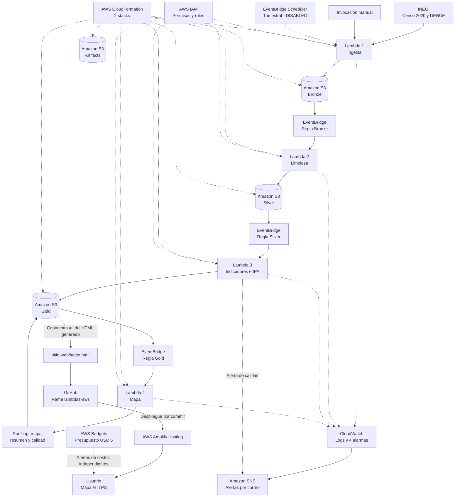

# Pharmacy Pulse · ¿Dónde abrir la primera sucursal?

**Pipeline de ingeniería de datos serverless en AWS para identificar zonas con potencial de apertura de farmacias en la Ciudad de México.**

**Estado del proyecto:** Desplegado en AWS y con mapa interactivo publicado mediante AWS Amplify.

**Última actualización:** 19 de noviembre de 2026.

**Región de AWS:** `us-east-2` — Ohio.

**Rama de despliegue:** `lambdas-aws`.

### Enlaces principales

- **Mapa interactivo publicado:** https://lambdas-aws.d92ev7hgxukb4.amplifyapp.com
- **Repositorio GitHub:** https://github.com/Brismar23/Pharmacy-Pulse---Equipo-6
- **Rama AWS:** https://github.com/Brismar23/Pharmacy-Pulse---Equipo-6/tree/lambdas-aws
- **Código de publicación:** `sitio-web/index.html`
- **Configuración de Amplify:** `amplify.yml`

---

## 1. Descripción del proyecto

**Pharmacy Pulse** es una solución de ingeniería de datos desarrollada sobre Amazon Web Services (AWS) que permite analizar y priorizar zonas de la Ciudad de México para identificar ubicaciones potenciales para la apertura de una primera sucursal farmacéutica.

La solución utiliza información pública del Instituto Nacional de Estadística y Geografía (INEGI), principalmente:

- Censo de Población y Vivienda 2020, con información por Área Geoestadística Básica (AGEB).
- Directorio Estadístico Nacional de Unidades Económicas (DENUE), para identificar farmacias existentes, consultorios y unidades relacionadas con servicios de salud.

Los datos se descargan, almacenan, limpian y validan mediante un pipeline automatizado de cuatro funciones AWS Lambda.

Posteriormente se calcula un **Índice de Potencial de Apertura (IPA)** con valores de 0 a 100, que permite comparar zonas según variables demográficas, demanda potencial, servicios de salud y competencia.

Los resultados se presentan mediante:

1. Un ranking de las zonas con mayor potencial.
2. Un mapa geográfico interactivo.
3. Un resumen de los principales hallazgos.
4. Un reporte de calidad de datos.
5. Archivos de resultados reproducibles almacenados en Amazon S3.

El mapa está publicado mediante AWS Amplify Hosting, con un enlace HTTPS que permite consultar los resultados desde un navegador.

### Alcance principal del proyecto

El análisis contratado comprende seis alcaldías de la Ciudad de México:

- Benito Juárez.
- Coyoacán.
- Tlalpan.
- Iztapalapa.
- Gustavo A. Madero.
- Álvaro Obregón.

Estas alcaldías constituyen el alcance principal establecido en el RFP.

### Análisis exploratorio complementario

El repositorio también incluye un análisis exploratorio de las 16 alcaldías de la Ciudad de México, con técnicas de machine learning y visualizaciones geográficas.

Este trabajo complementa la investigación, pero no sustituye los entregables del RFP, cuyo alcance principal se limita a las seis alcaldías señaladas.

> **Nota metodológica:** El IPA es una medida de priorización relativa entre zonas y no constituye una predicción garantizada de ventas o rentabilidad. Las ubicaciones seleccionadas deben validarse posteriormente mediante visitas de campo, análisis de rentas, accesibilidad, flujo peatonal y disponibilidad de locales.

---

## 2. Objetivos del proyecto (RFP N1–N5)

| ID | Objetivo | Implementación |
|---|---|---|
| N1 | Generar un ranking de al menos 10 zonas con puntuaciones entre 0 y 100. | Cálculo de IPA, ranking y justificación de zonas |
| N2 | Analizar la demanda potencial por zona. | Población, adultos mayores, escolaridad y servicios de salud |
| N3 | Identificar la competencia farmacéutica. | Datos DENUE y conteo de farmacias en un radio de 500 metros |
| N4 | Presentar un mapa comprensible e interactivo. | Visualización con Leaflet, filtros y fichas informativas |
| N5 | Construir una solución reproducible. | CloudFormation, S3, Lambda, GitHub, pruebas y documentación |

### Objetivos técnicos complementarios

- Implementar una arquitectura serverless en AWS.
- Automatizar el procesamiento mediante eventos.
- Almacenar los datos utilizando un modelo medallón.
- Incorporar reglas de calidad, validación y trazabilidad.
- Monitorear las funciones y configurar alertas.
- Controlar costos mediante AWS Budgets.
- Versionar el código fuente en GitHub.
- Publicar el frontend mediante AWS Amplify.
- Facilitar la consulta de los resultados a través de un enlace HTTPS.

---

## 3. Arquitectura de la solución

La arquitectura utiliza un **pipeline de procesamiento de datos desacoplado por eventos**, junto con un mecanismo independiente de publicación del frontend.

El procesamiento se ejecuta en AWS Lambda y los resultados se almacenan en Amazon S3.

El sitio web se distribuye mediante AWS Amplify Hosting a partir del código versionado en GitHub.

### 3.1 Diagrama de arquitectura



**Nota:** Las conexiones punteadas representan relaciones de administración, monitoreo, configuración o publicación que no forman parte del flujo principal de procesamiento de datos.

La copia del mapa desde S3 Gold hacia el repositorio GitHub se realizó manualmente durante el despliegue inicial. Actualmente no existe una sincronización automática entre S3 Gold y AWS Amplify.

### 3.2 Servicios de AWS utilizados

| Servicio | Función dentro del proyecto | Estado verificado |
|---|---|---|
| AWS CloudFormation | Infraestructura como código | 2 stacks creados |
| Amazon S3 | Almacenamiento Bronze, Silver, Gold y Artifacts | 4 buckets creados |
| AWS Lambda | Procesamiento de datos mediante cuatro etapas | 4 funciones desplegadas y ejecutadas |
| Amazon EventBridge | Encadenamiento automático mediante manifiestos | 3 reglas habilitadas |
| EventBridge Scheduler | Programación de ejecuciones trimestrales | Configurado y deshabilitado |
| Amazon CloudWatch | Logs y monitoreo de errores | 4 alarmas en estado OK |
| Amazon SNS | Notificaciones técnicas por correo | Suscripción confirmada |
| AWS Budgets | Monitoreo de costos | Presupuesto de USD 5 |
| AWS IAM | Administración de roles y permisos | Roles utilizados en el despliegue |
| AWS Amplify Hosting | Alojamiento del mapa interactivo | Despliegue exitoso |
| GitHub | Control de versiones y fuente de publicación | Rama `lambdas-aws` conectada |

### 3.3 Arquitectura de almacenamiento medallón

Se implementó una arquitectura de datos organizada en tres capas principales y un bucket auxiliar de artefactos.

| Capa | Descripción |
|---|---|
| Bronze | Archivos originales descargados del INEGI, conservados con sus metadatos |
| Silver | Información limpia, estandarizada y validada |
| Gold | Indicadores, resultados, ranking, reportes y mapa |
| Artifacts | Paquetes ZIP del código ejecutable de las funciones Lambda |

Los cuatro buckets se encuentran en la región `us-east-2`.

### 3.4 Funciones AWS Lambda

**Lambda 1 — Ingesta**

Nombre: `pharmacy-pulse-dev-ingesta`

Responsabilidades:

- Descargar los archivos del Censo 2020 y DENUE.
- Conservar las fuentes originales.
- Generar metadatos de descarga.
- Calcular huellas SHA-256.
- Almacenar los archivos en Bronze.
- Generar el manifiesto que inicia la siguiente etapa.

**Lambda 2 — Limpieza**

Nombre: `pharmacy-pulse-dev-limpieza`

Responsabilidades:

- Leer los datos originales.
- Filtrar las seis alcaldías del proyecto.
- Estandarizar campos.
- Validar coordenadas geográficas.
- Aplicar las reglas R2 y R6.
- Almacenar los registros procesados en Silver.

**Lambda 3 — Indicadores**

Nombre: `pharmacy-pulse-dev-indicadores`

Responsabilidades:

- Integrar los datos del Censo y DENUE.
- Aplicar las reglas R1, R3, R4, R5, R7 y R8.
- Calcular los indicadores del IPA.
- Construir el ranking.
- Evaluar la calidad de los resultados.
- Publicar los archivos correspondientes en Gold.

**Lambda 4 — Mapa**

Nombre: `pharmacy-pulse-dev-mapa`

Responsabilidades:

- Leer los resultados de Gold.
- Generar el mapa interactivo HTML.
- Incorporar los datos geográficos y el ranking.
- Preparar la visualización con Leaflet.
- Generar el resumen de resultados.
- Almacenar los archivos finales en Gold.

Las cuatro funciones fueron desplegadas utilizando paquetes ZIP y Python 3.13.

---

## 4. Infraestructura desplegada en AWS

### 4.1 Región de implementación

La implementación se realizó en:

```text
us-east-2
US East (Ohio)
```

Inicialmente se intentó utilizar `us-east-1`, pero la cuenta presentó restricciones de permisos impuestas mediante una Service Control Policy (SCP).

Por este motivo, se utilizó `us-east-2`, región donde se validaron las plantillas y se desplegó correctamente la infraestructura.

Todas las operaciones de AWS CLI correspondientes a esta implementación deben utilizar la misma región.

### 4.2 CloudFormation

La infraestructura se desplegó mediante dos plantillas:

| Stack | Plantilla | Resultado |
|---|---|---|
| `pharmacy-pulse-dev-storage` | `infra/Buckets.yaml` | `CREATE_COMPLETE` |
| `pharmacy-pulse-dev-lambdas` | `infra/Lambdas.yaml` | `CREATE_COMPLETE` |

El primer stack crea la infraestructura de almacenamiento.

El segundo stack crea los recursos de procesamiento, automatización, alertas y monitoreo definidos en la plantilla.

Ambas pilas fueron verificadas en la consola de AWS CloudFormation el 19 de noviembre de 2026.

### 4.3 Buckets S3 creados

Los buckets implementados son:

```text
pharmacy-pulse-dev-artifacts-165161124071-us-east-2
pharmacy-pulse-dev-bronze-165161124071-us-east-2
pharmacy-pulse-dev-silver-165161124071-us-east-2
pharmacy-pulse-dev-gold-165161124071-us-east-2
```

El bucket Artifacts almacena los paquetes:

```text
lambdas/ingesta.zip
lambdas/limpieza.zip
lambdas/indicadores.zip
lambdas/mapa.zip
```

El bucket Gold conserva los productos generados por el procesamiento, entre ellos el ranking, el mapa y los reportes.

### 4.4 Automatización mediante EventBridge

Se verificó que existen tres reglas de patrones de eventos:

| Regla | Estado |
|---|---|
| `pharmacy-pulse-dev-bronze-manifiesto` | ENABLED |
| `pharmacy-pulse-dev-silver-manifiesto` | ENABLED |
| `pharmacy-pulse-dev-gold-manifiesto` | ENABLED |

Estas reglas permiten que la generación de manifiestos en las distintas capas active las siguientes etapas del pipeline.

### 4.5 Programación trimestral

La programación de ingesta se encuentra configurada mediante EventBridge Scheduler.

```text
Nombre: pharmacy-pulse-dev-ingesta-trimestral
Estado: DISABLED
```

El calendario permite preparar ejecuciones trimestrales; sin embargo, permanece deshabilitado.

La primera carga real se inició manualmente.

No es necesario habilitar el calendario para utilizar el mapa ya publicado.

---

## 5. Resultados de la primera ejecución real

La primera carga se ejecutó el **19 de noviembre de 2026** mediante AWS Lambda, utilizando datos públicos del INEGI.

La ejecución se verificó mediante los registros de Amazon CloudWatch.

### 5.1 Resultados por etapa

| Etapa | Resultado | Estado |
|---|---|---|
| Ingesta | Descarga correcta de Censo y DENUE | Completada |
| Limpieza | 239,955 registros retenidos; 3 coordenadas inválidas descartadas | OK |
| Indicadores | 1,380 zonas procesadas | APROBADO |
| Mapa | 1,377 zonas representadas y 27,244 puntos | OK |

La diferencia entre las zonas procesadas y las zonas representadas corresponde a los resultados registrados por las distintas etapas. No debe interpretarse como una pérdida de registros sin revisar las reglas de selección y representación.

### 5.2 Descarga de fuentes

La ingesta descargó:

| Fuente | Tamaño aproximado |
|---|---|
| Censo 2020 AGEB urbana | 13 MB |
| DENUE CDMX | 45 MB |

Se registraron metadatos de descarga, fechas, tamaño y SHA-256 de los archivos originales.

### 5.3 Resultados del IPA

El análisis permitió ordenar las zonas según su potencial relativo.

Entre las principales zonas identificadas en la primera ejecución se encuentran:

| Posición | Zona | Alcaldía | IPA |
|---|---|---|---|
| 1 | Portales Norte | Benito Juárez | 81.4 |
| 2 | Prado Churubusco | Coyoacán | 80.6 |
| 3 | Del Valle Norte | Benito Juárez | 80.5 |
| 4 | Ciudad de los Deportes | Benito Juárez | 80.4 |
| 5 | Tetelpan | Álvaro Obregón | 79.6 |

Estos resultados corresponden a la ejecución del pipeline del 19 de noviembre de 2026.

El ranking completo se encuentra en:

```text
s3://<gold-bucket>/ranking/actual/ranking.csv
```

### 5.4 Archivos generados

La ejecución produjo los siguientes entregables principales:

| Archivo local | Descripción |
|---|---|
| `outputs/mapa.html` | Mapa interactivo |
| `outputs/ranking.csv` | Ranking de zonas |
| `outputs/resumen.md` | Resumen del análisis |
| `outputs/reporte_calidad.json` | Resultado de las reglas de calidad |

Los archivos descargados provienen de los objetos correspondientes almacenados en S3 Gold.

También pueden generarse archivos auxiliares, como `zonas_ipa.csv`, según la modalidad de ejecución.

---

## 6. Mapa interactivo publicado

### 6.1 Sitio público

El resultado principal está disponible en:

**https://lambdas-aws.d92ev7hgxukb4.amplifyapp.com**

El sitio fue desplegado mediante AWS Amplify Hosting y utiliza HTTPS.

La versión publicada se generó con los resultados del pipeline ejecutado el 19 de noviembre de 2026.

### 6.2 Funcionalidades del mapa

El frontend utiliza Leaflet y OpenStreetMap como tecnología de visualización geográfica.

El mapa incorpora:

- Visualización de zonas por AGEB.
- Índice de Potencial de Apertura entre 0 y 100.
- Colores según el potencial relativo.
- Círculos de tamaño variable según la población.
- Filtros por alcaldía.
- Capa de farmacias existentes.
- Capa de consultorios y hospitales.
- Ranking de las diez zonas con mayor potencial.
- Fichas informativas al seleccionar zonas.
- Controles de acercamiento y alejamiento.
- Indicadores de competencia, población y características demográficas.

La publicación fue verificada desde un navegador y el mapa se visualizó correctamente con su cartografía, ranking y elementos geográficos.

### 6.3 Publicación mediante GitHub y AWS Amplify

El frontend está versionado dentro del repositorio del equipo:

```text
sitio-web/
└── index.html
```

Se utiliza la rama:

```text
lambdas-aws
```

Amplify está conectado con GitHub y toma el contenido de esta rama para realizar los despliegues.

La configuración se encuentra en la raíz del repositorio:

`amplify.yml`

```yaml
version: 1
frontend:
  phases:
    build:
      commands: []
  artifacts:
    baseDirectory: sitio-web
    files:
      - '**/*'
  cache:
    paths: []
```

Como la página es estática, no necesita instalar dependencias ni ejecutar una compilación de React, Vite u otro framework frontend.

Amplify publica los archivos presentes en `sitio-web`.

### 6.4 Procedimiento utilizado para publicar el mapa

Después de completar las cuatro Lambdas:

1. Se descargó el mapa generado desde S3 Gold.
2. Se conservó una copia local en `outputs/mapa.html`.
3. Se creó la carpeta `sitio-web`.
4. Se copió `mapa.html` como `sitio-web/index.html`.
5. Se realizó un commit en la rama `lambdas-aws`.
6. Se subió el archivo al repositorio GitHub.
7. Se conectó el repositorio con AWS Amplify.
8. Se agregó el archivo `amplify.yml`.
9. Se corrigió el directorio de publicación.
10. Se verificó una implementación exitosa.
11. Se abrió el enlace público y se comprobó la visualización del mapa.

El primer despliegue presentó un error de directorio de artefactos. Se corrigió configurando:

```yaml
baseDirectory: sitio-web
```

Posteriormente, la implementación terminó correctamente.

### 6.5 Actualizaciones del mapa publicado

**Importante:** el frontend publicado es una representación estática de los resultados de una ejecución.

AWS Amplify detecta cambios en GitHub y puede desplegar nuevas versiones del sitio, pero no recupera automáticamente los nuevos archivos de S3 Gold.

Para actualizar el mapa después de una nueva ejecución del pipeline:

```bash
AWS_REGION=us-east-2 ./scripts/descargar_resultados.sh

mkdir -p sitio-web
cp outputs/mapa.html sitio-web/index.html
```

Posteriormente:

```bash
git add sitio-web/index.html
git commit -m "Actualizar mapa Pharmacy Pulse"
git push origin lambdas-aws
```

Antes de realizar el `push`, se debe actualizar la rama local con los cambios remotos y revisar que no existan modificaciones pendientes de otros integrantes.

Una vez actualizado GitHub, Amplify podrá ejecutar automáticamente un nuevo despliegue.

No se debe utilizar `git push --force` para actualizar la rama compartida.

---

## 7. Estructura del repositorio

La rama `lambdas-aws` contiene el código fuente del pipeline, la infraestructura, las pruebas y los archivos necesarios para publicar el mapa.

```text
Pharmacy-Pulse---Equipo-6/
│
├── README.md
├── Makefile
├── amplify.yml
├── .gitignore
├── requirements-dev.txt
├── requirements-analisis.txt
│
├── infra/
│   ├── Buckets.yaml
│   └── Lambdas.yaml
│
├── src/
│   ├── comun/
│   ├── ingesta/
│   │   └── handler.py
│   ├── limpieza/
│   │   └── handler.py
│   ├── indicadores/
│   │   └── handler.py
│   └── mapa/
│       └── handler.py
│
├── scripts/
│   ├── build.sh
│   ├── deploy.sh
│   ├── descargar_resultados.sh
│   ├── run_local.py
│   ├── generar_muestra.py
│   └── analisis/
│       ├── extraer_inegi_navegador.js
│       ├── analisis_cdmx.py
│       ├── graficas.py
│       ├── demo.py
│       └── demo_plantilla.html
│
├── sitio-web/
│   └── index.html
│
├── data/
│   ├── extraido/
│   └── resultados/
│
├── tests/
│   └── test_pipeline.py
│
└── docs/
    ├── adr/
    ├── consultoria/
    ├── datos/
    │   └── fuentes_y_extraccion.md
    ├── resultados/
    ├── demo/
    ├── data_dictionary.md
    └── decision_log.md
```

Las carpetas `outputs/` y `dist/` se generan durante la ejecución y construcción del proyecto, respectivamente; no forman parte obligatoria del código versionado.

---

## 8. Documentación del proyecto

El repositorio incluye documentación funcional, técnica y arquitectónica.

### Documentos principales

- [RFP](docs/consultoria/rfp.md)
- [SOW v2.0](docs/consultoria/sow.md)
- [Diagrama y documentación de arquitectura](docs/consultoria/documentacion-diagrama-arquitectura.md)
- [Fuentes de datos y extracción](docs/datos/fuentes_y_extraccion.md)
- [Diccionario de datos y linaje](docs/data_dictionary.md)
- [Bitácora de decisiones](docs/decision_log.md)
- [Resultados del análisis exploratorio](docs/resultados/README.md)
- [Demo complementaria](docs/demo/LEEME.md)

### Decisiones de arquitectura (ADR)

- **ADR 0001:** Alcance y complejidad del cálculo.
- **ADR 0002:** Selección de AWS Lambda frente a AWS Glue.
- **ADR 0003:** Infraestructura con dos plantillas CloudFormation.
- **ADR 0004:** Machine learning como análisis exploratorio complementario.

La arquitectura desplegada corresponde al modelo de almacenamiento S3, procesamiento Lambda y encadenamiento mediante EventBridge.

AWS Amplify se agregó como componente de publicación web independiente del pipeline de procesamiento.

---

## 9. Ejecución local

### 9.1 Requisitos

Para ejecutar el proyecto localmente se necesita:

- Python 3.11 o superior.
- Git.
- Acceso al repositorio.
- Dependencias de desarrollo.
- Acceso a los archivos del INEGI si se desea utilizar información real.

### 9.2 Clonar el repositorio

```bash
git clone https://github.com/Brismar23/Pharmacy-Pulse---Equipo-6.git

cd Pharmacy-Pulse---Equipo-6

git checkout lambdas-aws
```

### 9.3 Crear un entorno virtual

```bash
python3 -m venv .venv

source .venv/bin/activate

python3 -m pip install -r requirements-dev.txt
```

En Windows puede ser necesario utilizar `python` o `py` en lugar de `python3`.

### 9.4 Ejecutar pruebas automatizadas

```bash
make test
```

O directamente:

```bash
python3 -m unittest discover -s tests -v
```

### 9.5 Ejecutar el pipeline local

```bash
make muestra

make local
```

También es posible ejecutarlo mediante:

```bash
python3 scripts/run_local.py
```

Por defecto, la ejecución local utiliza datos sintéticos preparados para pruebas.

### 9.6 Ejecutar con datos reales

Se pueden descargar los archivos oficiales del INEGI:

- [Censo 2020 por AGEB urbana, CDMX](https://www.inegi.org.mx/contenidos/programas/ccpv/2020/datosabiertos/ageb_manzana/ageb_mza_urbana_09_cpv2020_csv.zip)
- [DENUE CDMX](https://www.inegi.org.mx/contenidos/masiva/denue/denue_09_csv.zip)

Después ejecutar:

```bash
python3 scripts/run_local.py \
  --censo ruta/ageb_mza_urbana_09_cpv2020_csv.zip \
  --denue ruta/denue_09_csv.zip
```

Los resultados se generan dentro de `outputs/`.

---

## 10. Despliegue en AWS

### 10.1 Requisitos de AWS

Se necesita una identidad de trabajo con permisos apropiados para:

- CloudFormation.
- Amazon S3.
- AWS Lambda.
- IAM.
- EventBridge.
- SNS.
- CloudWatch.
- Budgets.

También se requiere AWS CLI v2 si se realiza el despliegue desde terminal.

No se deben almacenar claves de acceso, contraseñas o tokens dentro del repositorio.

### 10.2 Configuración de región

Para reproducir el despliegue utilizado en este proyecto:

```bash
export AWS_DEFAULT_REGION=us-east-2
export AWS_REGION=us-east-2
```

Verificar:

```bash
aws --version

aws sts get-caller-identity

echo "$AWS_REGION"
```

### 10.3 Validar plantillas CloudFormation

Antes de desplegar:

```bash
aws cloudformation validate-template \
  --template-body file://infra/Buckets.yaml \
  --region us-east-2
```

```bash
aws cloudformation validate-template \
  --template-body file://infra/Lambdas.yaml \
  --region us-east-2
```

Ambas plantillas fueron validadas correctamente durante el despliegue original.

### 10.4 Crear infraestructura de almacenamiento

```bash
aws cloudformation deploy \
  --template-file infra/Buckets.yaml \
  --stack-name pharmacy-pulse-dev-storage \
  --parameter-overrides \
    ProjectName=pharmacy-pulse \
    Environment=dev \
  --region us-east-2 \
  --no-fail-on-empty-changeset
```

### 10.5 Construir paquetes Lambda

```bash
./scripts/build.sh
```

Genera:

```text
dist/ingesta.zip
dist/limpieza.zip
dist/indicadores.zip
dist/mapa.zip
```

### 10.6 Desplegar el pipeline

El repositorio dispone del script:

```bash
AWS_REGION=us-east-2 \
ALERT_EMAIL=correo-del-equipo@ejemplo.com \
./scripts/deploy.sh
```

Sustituir el correo de ejemplo por la dirección autorizada para recibir alertas.

El script automatiza la preparación, despliegue y actualización de los recursos definidos en las plantillas.

**Advertencia:** antes de repetir el despliegue en un entorno existente, revisar los parámetros de CloudFormation y los recursos creados. No se deben crear stacks duplicados innecesariamente.

### 10.7 Primera ejecución del pipeline

La primera carga se realizó mediante una invocación asíncrona de la Lambda de ingesta:

```bash
aws lambda invoke \
  --function-name pharmacy-pulse-dev-ingesta \
  --region us-east-2 \
  --invocation-type Event \
  --payload '{}' \
  --cli-binary-format raw-in-base64-out \
  respuesta.json
```

La respuesta inicial fue:

```json
{
  "StatusCode": 202
}
```

Este código significa que Lambda aceptó la solicitud de ejecución.

**No demuestra por sí solo que todo el procesamiento haya terminado.**

Por ese motivo, se revisaron los logs de las cuatro funciones mediante CloudWatch y se validó la generación de los resultados en S3.

### 10.8 Consultar los logs

```bash
aws logs tail /aws/lambda/pharmacy-pulse-dev-ingesta \
  --region us-east-2 \
  --since 30m
```

```bash
aws logs tail /aws/lambda/pharmacy-pulse-dev-limpieza \
  --region us-east-2 \
  --since 30m
```

```bash
aws logs tail /aws/lambda/pharmacy-pulse-dev-indicadores \
  --region us-east-2 \
  --since 30m
```

```bash
aws logs tail /aws/lambda/pharmacy-pulse-dev-mapa \
  --region us-east-2 \
  --since 30m
```

Durante la ejecución del 19 de noviembre de 2026 se obtuvieron registros de finalización de las cuatro funciones.

---

## 11. Descarga y consulta de resultados

Para descargar los resultados generados desde Amazon S3:

```bash
AWS_REGION=us-east-2 ./scripts/descargar_resultados.sh
```

El script recupera los resultados principales desde Gold.

### Archivos de salida

```text
outputs/
├── mapa.html
├── ranking.csv
├── resumen.md
└── reporte_calidad.json
```

### Visualización local del mapa

El mapa HTML puede abrirse desde un navegador.

Durante las pruebas se detectó que abrir el archivo directamente con el protocolo `file://` podía ocasionar bloqueos de las teselas de OpenStreetMap.

Para comprobar la visualización mediante HTTP se utilizó un servidor local.

Desde la carpeta que contiene el archivo:

```bash
python3 -m http.server 8000
```

En Windows también puede utilizarse:

```bash
py -m http.server 8000
```

Después abrir:

```text
http://localhost:8000/mapa.html
```

Esto permite realizar la visualización mediante un servidor HTTP local.

Para la entrega, se recomienda utilizar directamente la URL pública de Amplify.

---

## 12. Reglas de calidad y trazabilidad

La solución incorpora controles de calidad de datos establecidos en el SOW.

### Reglas de calidad

Las reglas R1 a R8 se distribuyen entre las etapas de limpieza e indicadores.

Estas validaciones permiten identificar problemas en los datos antes de publicar los resultados.

Entre los controles contemplados están:

- Validaciones de estructura y formato.
- Comprobación de datos geográficos.
- Reglas sobre los registros procesados.
- Verificación de condiciones necesarias para calcular indicadores.
- Bloqueo de publicación ante condiciones críticas.
- Generación del reporte de calidad.

### Trazabilidad

Se utilizan manifiestos para registrar el avance entre etapas.

Los archivos originales se almacenan utilizando particiones por fecha:

```text
fecha=AAAA-MM-DD
```

Los metadatos permiten identificar el origen y la versión de los datos utilizados.

El archivo de calidad registra la evaluación de la carga y permite revisar las reglas ejecutadas.

### Idempotencia

El proyecto contempla pruebas de idempotencia para verificar que repetir una ejecución sobre los mismos datos y parámetros produzca resultados reproducibles.

### Pruebas automatizadas

El archivo `tests/test_pipeline.py` contiene pruebas orientadas a:

- Ejecución punta a punta.
- Validación de reglas de calidad.
- Idempotencia.
- Bloqueo de publicación.
- Reglas del IPA.
- Uso de S3 simulado mediante Moto.

La existencia de estas pruebas está documentada en el repositorio. Sus resultados deben conservarse como evidencia cuando se ejecute una nueva versión del proyecto.

---

## 13. Monitoreo y alertas

### 13.1 Amazon CloudWatch

Se crearon cuatro alarmas:

```text
pharmacy-pulse-dev-ingesta-errores
pharmacy-pulse-dev-limpieza-errores
pharmacy-pulse-dev-indicadores-errores
pharmacy-pulse-dev-mapa-errores
```

Durante la verificación del 19 de noviembre de 2026, las cuatro se encontraban en estado:

```text
OK
```

La consola también mostraba que las acciones de las alarmas estaban habilitadas.

Estas alarmas supervisan condiciones de error asociadas con las funciones Lambda.

### 13.2 Amazon SNS

Se creó el tema:

```text
pharmacy-pulse-dev-alertas
```

También se configuró una suscripción mediante protocolo EMAIL.

Inicialmente, la suscripción se encontraba pendiente de confirmación.

Posteriormente se confirmó desde el correo destinatario y la consola de Amazon SNS mostró el estado:

```text
Confirmed
```

La confirmación permite que el correo reciba notificaciones publicadas mediante el tema SNS.

### 13.3 AWS Budgets

Se verificó la existencia de un presupuesto mensual de:

**USD 5.00**

Durante la revisión, AWS mostraba un importe utilizado de USD 0.00.

El proyecto contempla alertas de consumo para supervisar los costos del entorno.

La cuenta también mostraba un límite de gasto de USD 20 en su configuración de facturación.

**Importante:** AWS Budgets permite supervisar gastos y generar alertas, pero no constituye por sí solo un mecanismo que detenga automáticamente el consumo.

La verificación del correo de AWS Budgets es independiente de la confirmación de la suscripción SNS y debe comprobarse en la configuración de sus destinatarios.

---

## 14. Parámetros configurables

La plantilla `infra/Lambdas.yaml` permite modificar parámetros operativos sin cambiar directamente el código Python.

| Parámetro | Valor predeterminado | Descripción |
|---|---|---|
| `PesosIpa` | Población 0.30, edades 0.15, ingreso 0.15, salud 0.10, competencia 0.30 | Ponderaciones para calcular el IPA |
| `RadioMetros` | 500 | Distancia para evaluar competencia y servicios cercanos |
| `MinPoblacion` | 500 | Población mínima considerada |
| `TopN` | 20 | Número de zonas del ranking |
| `ScheduleState` | `DISABLED` | Activación de la ejecución trimestral |
| `Alcaldias` | `003,005,007,010,012,014` | Alcaldías consideradas |
| `CensoUrl` | Fuente oficial INEGI | URL de descarga del Censo |
| `DenueUrl` | Fuente oficial INEGI | URL de descarga del DENUE |

Las ponderaciones del IPA deben sumar 1.

Al modificar parámetros mediante CloudFormation, deben revisarse los valores que se conservarán o restablecerán durante la actualización.

---

## 15. Análisis exploratorio complementario de las 16 alcaldías

El repositorio incluye un análisis adicional de la Ciudad de México mediante técnicas estadísticas, aprendizaje automático y visualizaciones geográficas.

Este análisis es complementario y no sustituye el procesamiento principal de las seis alcaldías.

### Herramientas y técnicas

- Python.
- Pandas.
- Scikit-learn.
- Matplotlib.
- K-means.
- Random Forest.
- Visualizaciones geográficas.

### Resultados exploratorios documentados

En el análisis complementario se reportaron:

- 2,301 zonas analizadas.
- Aproximadamente 9.1 millones de habitantes.
- 7,450 farmacias identificadas.
- 310 zonas con posibles huecos de cobertura farmacéutica.
- 8 zonas revisadas sin farmacia identificada a 500 metros mediante Google Maps.

Algunas zonas destacadas en el análisis exploratorio fueron:

- Granada.
- San Miguel Chapultepec.
- Tetelpan.
- Del Valle Norte.
- Ciudad de los Deportes.

Estos resultados deben interpretarse dentro de su metodología exploratoria y no confundirse con el ranking definitivo generado por el pipeline AWS del 19 de noviembre de 2026.

### Ejecución del análisis

```bash
pip install -r requirements-analisis.txt
```

```bash
make analisis
```

Los resultados y visualizaciones se documentan en:

[Resultados exploratorios](docs/resultados/README.md)

---

## 16. Validación técnica realizada en AWS

El 19 de noviembre de 2026 se llevó a cabo una revisión funcional y de infraestructura.

### 16.1 Resultados de la validación

| Recurso | Evidencia observada | Resultado |
|---|---|---|
| CloudFormation Storage | `CREATE_COMPLETE` | Correcto |
| CloudFormation Lambdas | `CREATE_COMPLETE` | Correcto |
| S3 | 4 buckets en `us-east-2` | Correcto |
| Lambda Ingesta | Ejecución terminada | Correcto |
| Lambda Limpieza | Estado OK | Correcto |
| Lambda Indicadores | Estado APROBADO | Correcto |
| Lambda Mapa | Estado OK | Correcto |
| EventBridge | 3 reglas habilitadas | Correcto |
| Scheduler | Estado DISABLED | Correcto |
| SNS | Suscripción confirmada | Correcto |
| CloudWatch | 4 alarmas OK | Correcto |
| AWS Budgets | Presupuesto de USD 5 creado | Correcto |
| GitHub | Commit de publicación en `lambdas-aws` | Correcto |
| AWS Amplify | Implementación exitosa | Correcto |
| Mapa público | Visualización en navegador | Correcto |

### 16.2 Verificación del procesamiento

Los logs de CloudWatch permitieron comprobar:

- Descarga de las dos fuentes originales.
- Procesamiento y limpieza.
- Cálculo de indicadores.
- Generación de resultados en Gold.
- Construcción del HTML interactivo.

La cadena completa fue ejecutada con datos reales del INEGI.

### 16.3 Verificación de la publicación

En Amplify se registró una implementación exitosa con:

- Compilación completada.
- Publicación completada.
- Repositorio GitHub conectado.
- Rama `lambdas-aws`.
- Directorio de artefactos `sitio-web`.
- URL HTTPS accesible.

El mapa mostró correctamente el ranking y la cartografía geográfica de OpenStreetMap.

### 16.4 Evidencias para la entrega

Para documentar formalmente la implementación, se recomienda conservar las capturas en:

```text
docs/evidencias/aws/
```

Organización propuesta:

```text
docs/evidencias/aws/
├── 01-cloudformation.png
├── 02-s3-buckets.png
├── 03-lambda-funciones.png
├── 04-eventbridge-reglas.png
├── 05-scheduler.png
├── 06-sns-confirmado.png
├── 07-cloudwatch-alarmas.png
├── 08-aws-budget.png
├── 09-amplify-despliegue.png
└── 10-mapa-publicado.png
```

Esta estructura es una propuesta de documentación; las capturas deberán incorporarse al repositorio si el equipo decide incluirlas en la entrega.

---

## 17. Seguridad y buenas prácticas

La implementación contempla controles relacionados con la seguridad de la información y el acceso a servicios AWS.

### Controles implementados o configurados

- Administración de permisos mediante IAM.
- Uso de roles para las funciones Lambda.
- Buckets S3 definidos mediante CloudFormation.
- Almacenamiento de fuentes originales con trazabilidad.
- Uso de manifiestos entre las etapas.
- Validaciones de calidad antes de generar resultados.
- Monitoreo mediante CloudWatch.
- Notificaciones mediante SNS.
- Supervisión de costos mediante AWS Budgets.
- Control de versiones mediante GitHub.
- Despliegue del frontend con HTTPS en AWS Amplify.

### Buenas prácticas operativas

- No subir claves AWS al repositorio.
- No almacenar tokens de GitHub en archivos versionados.
- Evitar modificar directamente la rama principal del equipo.
- Utilizar pull requests cuando corresponda.
- Revisar los cambios antes de desplegar.
- Mantener los buckets de datos con acceso restringido.
- Publicar mediante Amplify únicamente los artefactos del frontend.
- Conservar registros de ejecución y calidad.
- Evitar nuevas cargas de datos si no son necesarias.
- Supervisar periódicamente los costos.

El sitio web de Amplify es público, pero esto no requiere hacer públicos los buckets originales de S3.

---

## 18. Problemas encontrados y soluciones aplicadas

Durante el despliegue se presentaron incidencias técnicas que fueron identificadas y corregidas.

| Problema | Causa | Solución |
|---|---|---|
| `AccessDenied` en `us-east-1` | Restricción mediante SCP | Utilizar `us-east-2` |
| Git solicitaba identidad | `user.name` y `user.email` no configurados | Configurar identidad local de Git |
| Git solicitaba contraseña HTTPS | Autenticación necesaria | Instalar GitHub CLI y autenticar mediante navegador |
| Amplify devolvía error 403 | Permisos insuficientes de integración GitHub | Autorizar Amplify para el repositorio propietario |
| Error de directorio de artefactos | Ruta de salida incorrecta | Configurar `baseDirectory: sitio-web` |
| Error 403 de OpenStreetMap durante pruebas locales | Restricciones de acceso a teselas | Probar mediante servidor HTTP y validar hosting |
| SNS pendiente de confirmación | Correo no confirmado | Confirmar suscripción desde el correo |
| Programación no requerida | Scheduler creado pero sin activación | Mantener `DISABLED` |

Estos ajustes permitieron completar el procesamiento y la publicación del proyecto.

---

## 19. Limitaciones y trabajo futuro

Aunque la solución se encuentra desplegada y el mapa está publicado, se identifican oportunidades de mejora.

### 19.1 Actualización automática del frontend

Actualmente, el mapa debe copiarse desde los resultados del pipeline hacia `sitio-web/index.html` y actualizarse en GitHub.

Como mejora futura, puede diseñarse un mecanismo de publicación automatizada que actualice el frontend cuando el pipeline termine correctamente.

### 19.2 Programación periódica

El Scheduler trimestral está configurado, pero permanece desactivado.

Su activación debe depender de la necesidad operativa y de la disponibilidad de presupuesto.

### 19.3 Ampliación de formatos de almacenamiento

Actualmente la implementación utiliza archivos CSV.

Se pueden evaluar formatos como Parquet y motores analíticos como Athena o DuckDB para nuevas necesidades de consulta.

### 19.4 Validación comercial

El IPA debe complementarse con:

- Costos de renta.
- Disponibilidad inmobiliaria.
- Visitas físicas.
- Accesibilidad.
- Flujo peatonal.
- Información comercial adicional.

### 19.5 Actualización y mantenimiento

Deben revisarse periódicamente:

- Disponibilidad de los enlaces del INEGI.
- Configuración de IAM.
- Versiones de las dependencias.
- Estados de CloudWatch.
- Presupuesto AWS.
- Cambios en el repositorio.
- Funcionamiento de la URL pública.

---

## 20. Estado final del proyecto

**Fecha de validación:** 19 de noviembre de 2026.

El proyecto Pharmacy Pulse completó el despliegue de su infraestructura principal y la primera ejecución real de su pipeline de ingeniería de datos en AWS.

Se verificaron los siguientes resultados:

- Dos stacks de CloudFormation creados.
- Cuatro buckets de Amazon S3 disponibles.
- Cuatro funciones Lambda desplegadas y ejecutadas.
- Tres reglas EventBridge habilitadas.
- Scheduler trimestral configurado y desactivado.
- Suscripción de Amazon SNS confirmada.
- Cuatro alarmas CloudWatch en estado OK.
- Presupuesto AWS de USD 5 creado.
- Procesamiento real de información del INEGI.
- Generación del ranking y del mapa interactivo.
- Repositorio GitHub conectado con AWS Amplify.
- Publicación exitosa del frontend.
- Acceso al mapa mediante HTTPS.

La solución permite consultar los resultados del Índice de Potencial de Apertura y proporciona una base reproducible para futuros análisis.

La publicación web corresponde a una versión estática de los datos procesados y se actualiza mediante cambios en el repositorio de GitHub.

**Mapa publicado:**

https://lambdas-aws.d92ev7hgxukb4.amplifyapp.com

---

## 21. Equipo de desarrollo

| Integrante | Rol |
|---|---|
| Brisa Mariana Gómez Luna | Project Manager y documentación |
| Javier de Jesús Infante Martínez | Data Engineer de ingesta y plataforma |
| Ana Paula González Frías | Data Engineer de transformación |
| Karen Pamela Rico Juárez | Data Quality & Governance Engineer — calidad, gobierno y mapa |

El proyecto fue desarrollado de manera colaborativa mediante GitHub, utilizando diferentes ramas para organizar el trabajo y conservar el historial de cambios.

---

## 22. Fuentes y referencias

### Datos

- Instituto Nacional de Estadística y Geografía (INEGI). Censo de Población y Vivienda 2020.
- INEGI. Directorio Estadístico Nacional de Unidades Económicas (DENUE).

### Servicios y tecnologías

- Amazon Web Services. AWS Lambda.
- Amazon Web Services. Amazon Simple Storage Service (S3).
- Amazon Web Services. AWS CloudFormation.
- Amazon Web Services. Amazon EventBridge.
- Amazon Web Services. Amazon CloudWatch.
- Amazon Web Services. Amazon SNS.
- Amazon Web Services. AWS Budgets.
- Amazon Web Services. AWS Amplify Hosting.
- GitHub. Control de versiones Git.
- Leaflet. Biblioteca JavaScript de mapas interactivos.
- OpenStreetMap. Cartografía geográfica.

### Enlaces

- https://www.inegi.org.mx/
- https://aws.amazon.com/
- https://docs.aws.amazon.com/
- https://github.com/
- https://leafletjs.com/
- https://www.openstreetmap.org/

---

**Pharmacy Pulse — Equipo 6**

*Ingeniería de datos, automatización serverless y análisis geográfico para apoyar decisiones de ubicación comercial.*
