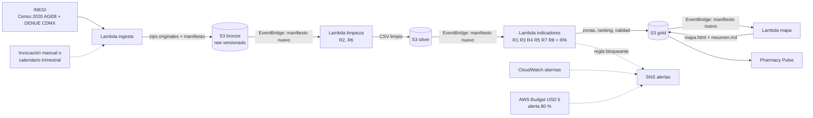

# Pharmacy Pulse · ¿Dónde abrir la primera sucursal?

Pipeline de ingeniería de datos en AWS que toma datos públicos del INEGI (Censo 2020 por AGEB y DENUE), los limpia y valida con reglas de calidad, y publica un **ranking de zonas con un Índice de Potencial de Apertura (IPA, 0 a 100)**, un **mapa** y un **resumen** para que Pharmacy Pulse decida dónde buscar local en Benito Juárez, Coyoacán, Tlalpan, Iztapalapa, Gustavo A. Madero y Álvaro Obregón.

**Alcance principal del proyecto:** Desarrollar una solución de ingeniería de datos en AWS que permita priorizar zonas para la primera sucursal de Pharmacy Pulse, utilizando información pública del INEGI. El análisis contratado comprende seis alcaldías: Benito Juárez, Coyoacán, Tlalpan, Iztapalapa, Gustavo A. Madero y Álvaro Obregón.

**Análisis exploratorio complementario:** Se incluye un estudio adicional de las 16 alcaldías de la Ciudad de México, con técnicas de machine learning y visualizaciones geográficas. Este análisis complementa la investigación, pero no sustituye los entregables establecidos en el RFP.


> El IPA es una **priorización relativa** entre zonas, no un pronóstico de ventas. Las zonas del top se validan después en campo (rentas, flujo peatonal, locales disponibles).

## Objetivos (RFP N1-N5)

* **N1** Ranking de al menos 10 zonas con puntaje 0-100 y el "por qué" de cada una.
* **N2** Demanda por zona: población, adultos mayores, escolaridad (sustituto de ingreso) y unidades de salud cercanas.
* **N3** Competencia: farmacias del DENUE a menos de 500 m, y unidades de salud por separado.
* **N4** Mapa que se abre con doble clic y se entiende en menos de 5 minutos.
* **N5** Repetible: infraestructura como código, `raw` versionado, pruebas y este README.

## Arquitectura



* **Cuatro funciones AWS Lambda en Python 3.13**, organizadas por etapa: ingesta, limpieza, indicadores y generación del mapa.
* **Data lake medallón en S3**: un bucket por capa (`bronze`, `silver`, `gold`) más `artifacts` para el código.
* **Encadenamiento por eventos**: cada Lambda escribe un manifiesto al terminar y ese manifiesto dispara a la siguiente.
* **CloudFormation en dos plantillas**: `infra/Buckets.yaml` (datos) e `infra/Lambdas.yaml` (cómputo, alertas, presupuesto).

## Estructura del repositorio

```text
.
├── README.md
├── Makefile                         # make test | local | deploy | analisis
├── requirements-dev.txt             # pruebas (boto3, moto, cfn-lint)
├── requirements-analisis.txt        # análisis exploratorio (pandas, scikit-learn, matplotlib)
├── infra/
│   ├── Buckets.yaml                 # CloudFormation 1/2: buckets bronze, silver, gold, artifacts
│   └── Lambdas.yaml                 # CloudFormation 2/2: 4 Lambdas, EventBridge, SNS, alarmas, Budget
├── src/                             # código de las Lambdas (Python 3.13, solo biblioteca estándar)
│   ├── comun/                       # código compartido (se copia dentro de cada zip)
│   ├── ingesta/handler.py           # INEGI -> bronze
│   ├── limpieza/handler.py          # bronze -> silver (R2, R6)
│   ├── indicadores/handler.py       # silver -> gold (R1, R3, R4, R5, R7, R8, IPA, ranking)
│   └── mapa/                        # gold -> mapa HTML (Leaflet incluido) y resumen
├── scripts/
│   ├── build.sh                     # genera dist/<lambda>.zip
│   ├── deploy.sh                    # despliega todo con la AWS CLI
│   ├── descargar_resultados.sh      # baja ranking, mapa y reporte de gold
│   ├── run_local.py                 # corre las 4 Lambdas en tu compu, sin AWS
│   ├── generar_muestra.py           # muestra SINTÉTICA con formato INEGI para pruebas
│   └── analisis/
│       ├── extraer_inegi_navegador.js   # extracción del INEGI desde la consola del navegador
│       ├── analisis_cdmx.py             # indicadores, k-means, random forest, zonas con hueco
│       ├── graficas.py                  # 9 gráficas -> docs/resultados/
│       └── demo.py, demo_plantilla.html # demo web -> docs/demo/index.html
├── data/
│   ├── extraido/                    # CSV extraídos del INEGI + verificación en Google Maps
│   └── resultados/                  # tabla final por zona y resumen por alcaldía
├── tests/test_pipeline.py           # punta a punta, idempotencia, bloqueo, S3 simulado
└── docs/
    ├── adr/                         # decisiones de arquitectura (0001-0004)
    ├── consultoria/                 # RFP, SOW y diagrama
    ├── datos/fuentes_y_extraccion.md    # de dónde salen los datos y cómo se extraen
    ├── resultados/                  # hallazgos y gráficas
    ├── demo/                        # demo web (index.html)
    ├── data_dictionary.md           # diccionario, fichas de fuente, linaje y reglas
    └── decision_log.md              # decisiones a validar con el cliente
```

### Componentes y decisiones de arquitectura

| Componente | Función |
|---|---|
| Amazon S3 Bronze | Almacena las fuentes originales del INEGI y sus versiones |
| Amazon S3 Silver | Conserva los datos limpios y estandarizados en CSV |
| Amazon S3 Gold | Almacena indicadores, ranking, reporte de calidad y mapa |
| Amazon S3 Artifacts | Almacena los paquetes de código de las funciones Lambda |
| AWS Lambda | Ejecuta las cuatro etapas del pipeline |
| Amazon EventBridge | Encadena las etapas mediante eventos y manifiestos |
| AWS CloudFormation | Permite desplegar infraestructura reproducible |
| Amazon CloudWatch | Registra ejecuciones y monitorea errores |
| Amazon SNS | Envía alertas técnicas |
| AWS Budgets | Genera alertas de costos según umbrales configurados |
| IAM | Administra permisos de acceso a los recursos |

**Ejecución:** La ingesta se inicia manualmente por defecto. La programación trimestral está definida, pero deshabilitada hasta que se active expresamente.

**Formato de datos:** La implementación actual utiliza CSV en Silver y Gold. Parquet y las consultas analíticas mediante Athena o DuckDB quedan como alternativas sujetas a evaluación.

**Seguridad:** Los buckets están configurados como privados, con cifrado y control de acceso. La aplicación efectiva de estas configuraciones se verificará durante el despliegue en AWS.

## Documentos

* [RFP](docs/consultoria/rfp.md) y [SOW v2.0](docs/consultoria/sow.md).
* [ADR 0001](docs/adr/0001-alcance-y-complejidad-del-calculo.md): qué tanto calculamos y qué no.
* [ADR 0002](docs/adr/0002-lambda-vs-glue.md): Lambda frente a Glue.
* [ADR 0003](docs/adr/0003-cloudformation-dos-plantillas.md): CloudFormation en dos plantillas.
* [ADR 0004](docs/adr/0004-machine-learning-exploratorio.md): machine learning solo como análisis exploratorio.
* [Fuentes de datos y cómo se extraen](docs/datos/fuentes_y_extraccion.md).
* [Resultados del análisis de la CDMX](docs/resultados/README.md) · [Demo web](docs/demo/LEEME.md).
* [Diccionario de datos y linaje](docs/data_dictionary.md) · [Bitácora de decisiones](docs/decision_log.md).
* [Diagrama de arquitectura](docs/consultoria/documentacion-diagrama-arquitectura.md) (Diagramon).

## Cómo correrlo

### 1. En tu computadora, sin AWS (5 minutos)

Solo necesitas Python 3.11 o superior.

Primero, clona el repositorio y prepara las dependencias:

```bash
git clone https://github.com/Brismar23/Pharmacy-Pulse---Equipo-6.git
cd Pharmacy-Pulse---Equipo-6

python3 -m venv .venv
source .venv/bin/activate

python3 -m pip install -r requirements-dev.txt
```

Para verificar la implementación local:

```bash
make test
make local
```

`make test` ejecuta las pruebas automatizadas.

`make local` utiliza datos sintéticos de prueba y ejecuta las cuatro etapas sin desplegar recursos en AWS.

Para ejecutar el pipeline con datos reales deben utilizarse los archivos públicos del INEGI indicados en la siguiente sección.


```bash
python3 scripts/run_local.py            # usa la muestra SINTÉTICA
python3 -m unittest discover -s tests   # pruebas (las de S3 simulado piden: pip install -r requirements-dev.txt)
```

Con datos reales: descarga los dos zips del INEGI ([Censo AGEB CDMX](https://www.inegi.org.mx/contenidos/programas/ccpv/2020/datosabiertos/ageb_manzana/ageb_mza_urbana_09_cpv2020_csv.zip) y [DENUE CDMX](https://www.inegi.org.mx/contenidos/masiva/denue/denue_09_csv.zip)) y:

```bash
python3 scripts/run_local.py --censo ruta/ageb_mza_urbana_09_cpv2020_csv.zip --denue ruta/denue_09_csv.zip
```

Resultados en `outputs/`: `ranking.csv`, `mapa.html`, `resumen.md`, `reporte_calidad.json`, `zonas_ipa.csv`.

### 2. Despliegue en AWS con la CLI (15 minutos)

### Preparación y validación de AWS

Antes de desplegar:

1. Utilizar una cuenta AWS con MFA y una identidad de trabajo con permisos apropiados.
2. Verificar que AWS CLI v2 esté instalada y configurada.
3. Comprobar la identidad y región seleccionadas.
4. Revisar los servicios y costos aplicables.
5. Configurar un correo real para las alertas.

Comandos de verificación:

```bash
aws --version
aws sts get-caller-identity
aws configure get region
```

El despliegue debe realizarse primero en un entorno de desarrollo (`dev`).

El script `scripts/deploy.sh` crea o actualiza los stacks de almacenamiento y procesamiento mediante CloudFormation.

**Importante:** una invocación aceptada por AWS Lambda no demuestra que todo el pipeline finalizó correctamente. Se deben revisar los registros, manifiestos y archivos de salida.

Requisitos: AWS CLI v2 configurada (`aws configure`) con permisos de CloudFormation, S3, Lambda, IAM, EventBridge, SNS, CloudWatch y Budgets.

```bash
AWS_REGION=us-east-1 ALERT_EMAIL=equipo@correo.com ./scripts/deploy.sh
aws lambda invoke --function-name pharmacy-pulse-dev-ingesta --invocation-type Event \
    --payload '{}' --cli-binary-format raw-in-base64-out /dev/stdout
# 3-5 minutos después:
./scripts/descargar_resultados.sh
```

Confirma el correo de suscripción de SNS para recibir alertas.

### 3. En AWS desde la consola (sin CLI)

1. **CloudFormation → Crear pila** con `infra/Buckets.yaml`, nombre `pharmacy-pulse-dev-storage`.
2. Corre `./scripts/build.sh` (o comprime cada `src/<lambda>/handler.py` junto con la carpeta `src/comun/`) y sube `ingesta.zip`, `limpieza.zip`, `indicadores.zip` y `mapa.zip` a la carpeta `lambdas/` del bucket `...-artifacts-...`.
3. **CloudFormation → Crear pila** con `infra/Lambdas.yaml`, nombre `pharmacy-pulse-dev-lambdas`; marca la casilla de IAM y pon tu correo en `AlertEmail`.
4. **Lambda → pharmacy-pulse-dev-ingesta → Probar** con el evento `{}`.
5. En unos minutos, descarga `mapa/actual/index.html` y `ranking/actual/ranking.csv` del bucket `...-gold-...`.

### Si INEGI bloquea la descarga desde AWS

Sube los dos zips a mano a bronze y avisa a la ingesta que ya están:

```bash
F=2026-11-23
aws s3 cp ageb_mza_urbana_09_cpv2020_csv.zip s3://<bronze>/censo/fecha=$F/
aws s3 cp denue_09_csv.zip s3://<bronze>/denue/fecha=$F/
aws lambda invoke --function-name pharmacy-pulse-dev-ingesta \
    --payload "{\"fecha\":\"$F\",\"solo_manifiesto\":true}" --cli-binary-format raw-in-base64-out /dev/stdout
```

### 4. Análisis exploratorio de la CDMX y demo

```bash
pip install -r requirements-analisis.txt
make analisis            # lee data/extraido/, escribe docs/resultados/, data/resultados/ y docs/demo/index.html
```

Para volver a extraer los datos del INEGI desde el navegador: [docs/datos/fuentes_y_extraccion.md](docs/datos/fuentes_y_extraccion.md). La demo se abre con doble clic en `docs/demo/index.html`.

## Resultados exploratorios de las 16 alcaldías

> Estos resultados corresponden al análisis exploratorio complementario. El ranking contractual definitivo debe limitarse a las seis alcaldías definidas en el RFP y validarse con la metodología aprobada.

* 2,301 zonas, 9.1 millones de habitantes, 7,450 farmacias.
* Más saturadas: Milpa Alta (13.1 farmacias por 10 mil hab.), Tláhuac (11.3), Iztapalapa (9.9). Con más espacio: Álvaro Obregón (5.5).
* Top IPA: Granada, San Miguel Chapultepec, Tetelpan, Del Valle Norte, Ciudad de los Deportes.
* 310 zonas con hueco de farmacias; 8 confirmadas sin farmacia a 500 m en Google Maps.

Detalle y gráficas: [docs/resultados/README.md](docs/resultados/README.md).

## Parámetros que se cambian sin tocar código (`infra/Lambdas.yaml`)

| Parámetro | Default | Para qué |
|---|---|---|
| `PesosIpa` | `{"poblacion":0.30,"edades":0.15,"ingreso":0.15,"salud":0.10,"competencia":0.30}` | Pesos del IPA (deben sumar 1) |
| `RadioMetros` | 500 | Radio para contar farmacias y unidades de salud |
| `MinPoblacion` | 500 | Habitantes mínimos para entrar al ranking |
| `TopN` | 20 | Zonas en `ranking.csv` |
| `ScheduleState` | `DISABLED` | Recarga trimestral automática |
| `Alcaldias` | `003,005,007,010,012,014` | Alcaldías del ranking (`todas` para las 16) |
| `CensoUrl`, `DenueUrl` | INEGI | Si INEGI cambia las rutas |

## Controles implementados en código y pendientes de validación AWS

* **bronze inmutable**: cada descarga va a `fecha=AAAA-MM-DD` y no se sobrescribe; el manifiesto guarda URL, tamaño y sha256.
* **Idempotente**: dos ejecuciones sobre la misma versión de bronze producen los mismos bytes en silver y gold (hay prueba).
* **Calidad**: R1-R8 del SOW en cada carga; si falla una bloqueante, no se publica el ranking y llega una alerta.
* **Trazable**: cada ranking registra su `version_raw`; el linaje está en `docs/data_dictionary.md`.
* **Costos:** La infraestructura incluye una configuración de AWS Budget de USD 5 mensuales, con alertas al superar el 80 % del gasto real y el 100 % del gasto previsto. Estas alertas no constituyen un límite automático de consumo. El costo real dependerá de la ejecución y los servicios utilizados.


## Validación técnica y evidencias AWS

La solución debe validarse tanto en el entorno local como en la infraestructura desplegada en AWS.

### 1. Pruebas automatizadas

```bash
python3 -m unittest discover -s tests -v
```

Las pruebas definidas en `tests/test_pipeline.py` incluyen:

- Ejecución punta a punta con datos sintéticos.
- Validación de reglas de calidad.
- Comprobación de idempotencia.
- Bloqueo de publicación ante errores críticos.
- Validación de ponderaciones del IPA.
- Integración con S3 simulado mediante Moto.

La existencia de estas pruebas no sustituye la verificación de su resultado.

### 2. Validación de infraestructura AWS

Registrar evidencia de:

| Recurso | Validación |
|---|---|
| CloudFormation | Stacks en estado CREATE_COMPLETE o UPDATE_COMPLETE |
| S3 | Existencia de buckets Bronze, Silver, Gold y Artifacts |
| Lambda | Cuatro funciones desplegadas y ejecutadas |
| EventBridge | Invocación de las etapas posteriores |
| CloudWatch | Logs de ejecución sin errores críticos |
| SNS | Suscripción de alertas confirmada |
| AWS Budgets | Presupuesto creado y alertas configuradas |

### 3. Validación de resultados

Verificar los siguientes objetos del bucket Gold:

- `ranking/actual/ranking.csv`
- `mapa/actual/index.html`
- `resumen/actual/resumen.md`
- Reporte de calidad correspondiente a la versión procesada.

El ranking debe contener al menos diez zonas pertenecientes a las seis alcaldías del RFP.

### 4. Evidencias documentales

Las capturas de pantalla, resultados de pruebas y registros de validación se incorporarán a `docs/evidencias/aws/`.


## Equipo

| Integrante | Rol |
|---|---|
| Brisa Mariana Gómez Luna | Project manager y documentación |
| Javier de Jesús Infante Martínez | Data Engineer de ingesta y plataforma |
| Ana Paula González Frías | Data Engineer de Transformación |
| Karen Pamela Rico Juárez | Data Quality & Governance Engineer — Calidad, gobierno y mapa |
