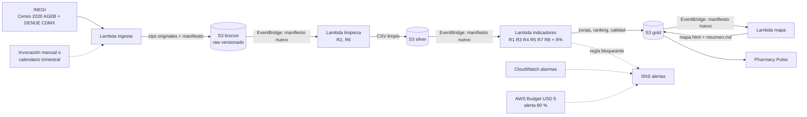

# Pharmacy Pulse · ¿Dónde abrir la primera sucursal?

Pipeline de ingeniería de datos en AWS que toma datos públicos del INEGI (Censo 2020 por AGEB y DENUE), los limpia y valida con reglas de calidad, y publica un **ranking de zonas con un Índice de Potencial de Apertura (IPA, 0 a 100)**, un **mapa** y un **resumen** para que Pharmacy Pulse decida dónde buscar local en Benito Juárez, Coyoacán, Tlalpan, Iztapalapa, Gustavo A. Madero y Álvaro Obregón.

Además, un **análisis exploratorio de las 16 alcaldías** con machine learning (tipos de zona y zonas con hueco de farmacias, confirmadas en Google Maps) y una **demo web** con filtros por alcaldía, edad, población y nivel socioeconómico.

> El IPA es una **priorización relativa** entre zonas, no un pronóstico de ventas. Las zonas del top se validan después en campo (rentas, flujo peatonal, locales disponibles).

## Objetivos (RFP N1-N5)

* **N1** Ranking de al menos 10 zonas con puntaje 0-100 y el "por qué" de cada una.
* **N2** Demanda por zona: población, adultos mayores, escolaridad (sustituto de ingreso) y unidades de salud cercanas.
* **N3** Competencia: farmacias del DENUE a menos de 500 m, y unidades de salud por separado.
* **N4** Mapa que se abre con doble clic y se entiende en menos de 5 minutos.
* **N5** Repetible: infraestructura como código, `raw` versionado, pruebas y este README.

## Arquitectura



* **Cuatro Lambdas en Python 3.13, solo biblioteca estándar** (sin capas). Una por capa.
* **Data lake medallón en S3**: un bucket por capa (`bronze`, `silver`, `gold`) más `artifacts` para el código.
* **Encadenamiento por eventos**: cada Lambda escribe un manifiesto al terminar y ese manifiesto dispara a la siguiente.
* **CloudFormation en dos plantillas**: `infra/Buckets.yaml` (datos) e `infra/Lambdas.yaml` (cómputo, alertas, presupuesto).

## Estructura del repositorio

```text
.
├── README.md
├── Makefile                         # make test | local | deploy | analisis
├── requirements-dev.txt             # pruebas (boto3, moto, cfn-lint)
├── requirements-analisis.txt        # análisis exploratorio (pandas, scikit-learn, matplotlib)
├── infra/
│   ├── Buckets.yaml                 # CloudFormation 1/2: buckets bronze, silver, gold, artifacts
│   └── Lambdas.yaml                 # CloudFormation 2/2: 4 Lambdas, EventBridge, SNS, alarmas, Budget
├── src/                             # código de las Lambdas (Python 3.13, solo biblioteca estándar)
│   ├── comun/                       # código compartido (se copia dentro de cada zip)
│   ├── ingesta/handler.py           # INEGI -> bronze
│   ├── limpieza/handler.py          # bronze -> silver (R2, R6)
│   ├── indicadores/handler.py       # silver -> gold (R1, R3, R4, R5, R7, R8, IPA, ranking)
│   └── mapa/                        # gold -> mapa HTML (Leaflet incluido) y resumen
├── scripts/
│   ├── build.sh                     # genera dist/<lambda>.zip
│   ├── deploy.sh                    # despliega todo con la AWS CLI
│   ├── descargar_resultados.sh      # baja ranking, mapa y reporte de gold
│   ├── run_local.py                 # corre las 4 Lambdas en tu compu, sin AWS
│   ├── generar_muestra.py           # muestra SINTÉTICA con formato INEGI para pruebas
│   └── analisis/
│       ├── extraer_inegi_navegador.js   # extracción del INEGI desde la consola del navegador
│       ├── analisis_cdmx.py             # indicadores, k-means, random forest, zonas con hueco
│       ├── graficas.py                  # 9 gráficas -> docs/resultados/
│       └── demo.py, demo_plantilla.html # demo web -> docs/demo/index.html
├── data/
│   ├── extraido/                    # CSV extraídos del INEGI + verificación en Google Maps
│   └── resultados/                  # tabla final por zona y resumen por alcaldía
├── tests/test_pipeline.py           # punta a punta, idempotencia, bloqueo, S3 simulado
└── docs/
    ├── adr/                         # decisiones de arquitectura (0001-0004)
    ├── consultoria/                 # RFP, SOW y diagrama
    ├── datos/fuentes_y_extraccion.md    # de dónde salen los datos y cómo se extraen
    ├── resultados/                  # hallazgos y gráficas
    ├── demo/                        # demo web (index.html)
    ├── data_dictionary.md           # diccionario, fichas de fuente, linaje y reglas
    └── decision_log.md              # decisiones a validar con el cliente
```

## Documentos

* [RFP](docs/consultoria/rfp.md) y [SOW v2.0](docs/consultoria/sow.md).
* [ADR 0001](docs/adr/0001-alcance-y-complejidad-del-calculo.md): qué tanto calculamos y qué no.
* [ADR 0002](docs/adr/0002-lambda-vs-glue.md): Lambda frente a Glue.
* [ADR 0003](docs/adr/0003-cloudformation-dos-plantillas.md): CloudFormation en dos plantillas.
* [ADR 0004](docs/adr/0004-machine-learning-exploratorio.md): machine learning solo como análisis exploratorio.
* [Fuentes de datos y cómo se extraen](docs/datos/fuentes_y_extraccion.md).
* [Resultados del análisis de la CDMX](docs/resultados/README.md) · [Demo web](docs/demo/LEEME.md).
* [Diccionario de datos y linaje](docs/data_dictionary.md) · [Bitácora de decisiones](docs/decision_log.md).
* [Diagrama de arquitectura](docs/consultoria/documentacion-diagrama-arquitectura.md) (Diagramon).

## Cómo correrlo

### 1. En tu computadora, sin AWS (5 minutos)

Solo necesitas Python 3.11 o superior.

```bash
python3 scripts/run_local.py            # usa la muestra SINTÉTICA
python3 -m unittest discover -s tests   # pruebas (las de S3 simulado piden: pip install -r requirements-dev.txt)
```

Con datos reales: descarga los dos zips del INEGI ([Censo AGEB CDMX](https://www.inegi.org.mx/contenidos/programas/ccpv/2020/datosabiertos/ageb_manzana/ageb_mza_urbana_09_cpv2020_csv.zip) y [DENUE CDMX](https://www.inegi.org.mx/contenidos/masiva/denue/denue_09_csv.zip)) y:

```bash
python3 scripts/run_local.py --censo ruta/ageb_mza_urbana_09_cpv2020_csv.zip --denue ruta/denue_09_csv.zip
```

Resultados en `outputs/`: `ranking.csv`, `mapa.html`, `resumen.md`, `reporte_calidad.json`, `zonas_ipa.csv`.

### 2. En AWS con la CLI (15 minutos)

Requisitos: AWS CLI v2 configurada (`aws configure`) con permisos de CloudFormation, S3, Lambda, IAM, EventBridge, SNS, CloudWatch y Budgets.

```bash
AWS_REGION=us-east-1 ALERT_EMAIL=equipo@correo.com ./scripts/deploy.sh
aws lambda invoke --function-name pharmacy-pulse-dev-ingesta --invocation-type Event \
    --payload '{}' --cli-binary-format raw-in-base64-out /dev/stdout
# 3-5 minutos después:
./scripts/descargar_resultados.sh
```

Confirma el correo de suscripción de SNS para recibir alertas.

### 3. En AWS desde la consola (sin CLI)

1. **CloudFormation → Crear pila** con `infra/Buckets.yaml`, nombre `pharmacy-pulse-dev-storage`.
2. Corre `./scripts/build.sh` (o comprime cada `src/<lambda>/handler.py` junto con la carpeta `src/comun/`) y sube `ingesta.zip`, `limpieza.zip`, `indicadores.zip` y `mapa.zip` a la carpeta `lambdas/` del bucket `...-artifacts-...`.
3. **CloudFormation → Crear pila** con `infra/Lambdas.yaml`, nombre `pharmacy-pulse-dev-lambdas`; marca la casilla de IAM y pon tu correo en `AlertEmail`.
4. **Lambda → pharmacy-pulse-dev-ingesta → Probar** con el evento `{}`.
5. En unos minutos, descarga `mapa/actual/index.html` y `ranking/actual/ranking.csv` del bucket `...-gold-...`.

### Si INEGI bloquea la descarga desde AWS

Sube los dos zips a mano a bronze y avisa a la ingesta que ya están:

```bash
F=2026-11-23
aws s3 cp ageb_mza_urbana_09_cpv2020_csv.zip s3://<bronze>/censo/fecha=$F/
aws s3 cp denue_09_csv.zip s3://<bronze>/denue/fecha=$F/
aws lambda invoke --function-name pharmacy-pulse-dev-ingesta \
    --payload "{\"fecha\":\"$F\",\"solo_manifiesto\":true}" --cli-binary-format raw-in-base64-out /dev/stdout
```

### 4. Análisis exploratorio de la CDMX y demo

```bash
pip install -r requirements-analisis.txt
make analisis            # lee data/extraido/, escribe docs/resultados/, data/resultados/ y docs/demo/index.html
```

Para volver a extraer los datos del INEGI desde el navegador: [docs/datos/fuentes_y_extraccion.md](docs/datos/fuentes_y_extraccion.md). La demo se abre con doble clic en `docs/demo/index.html`.

## Resultados principales (CDMX, datos reales)

* 2,301 zonas, 9.1 millones de habitantes, 7,450 farmacias.
* Más saturadas: Milpa Alta (13.1 farmacias por 10 mil hab.), Tláhuac (11.3), Iztapalapa (9.9). Con más espacio: Álvaro Obregón (5.5).
* Top IPA: Granada, San Miguel Chapultepec, Tetelpan, Del Valle Norte, Ciudad de los Deportes.
* 310 zonas con hueco de farmacias; 8 confirmadas sin farmacia a 500 m en Google Maps.

Detalle y gráficas: [docs/resultados/README.md](docs/resultados/README.md).

## Parámetros que se cambian sin tocar código (`infra/Lambdas.yaml`)

| Parámetro | Default | Para qué |
|---|---|---|
| `PesosIpa` | `{"poblacion":0.30,"edades":0.15,"ingreso":0.15,"salud":0.10,"competencia":0.30}` | Pesos del IPA (deben sumar 1) |
| `RadioMetros` | 500 | Radio para contar farmacias y unidades de salud |
| `MinPoblacion` | 500 | Habitantes mínimos para entrar al ranking |
| `TopN` | 20 | Zonas en `ranking.csv` |
| `ScheduleState` | `DISABLED` | Recarga trimestral automática |
| `Alcaldias` | `003,005,007,010,012,014` | Alcaldías del ranking (`todas` para las 16) |
| `CensoUrl`, `DenueUrl` | INEGI | Si INEGI cambia las rutas |

## Garantías del pipeline

* **bronze inmutable**: cada descarga va a `fecha=AAAA-MM-DD` y no se sobrescribe; el manifiesto guarda URL, tamaño y sha256.
* **Idempotente**: dos ejecuciones sobre la misma versión de bronze producen los mismos bytes en silver y gold (hay prueba).
* **Calidad**: R1-R8 del SOW en cada carga; si falla una bloqueante, no se publica el ranking y llega una alerta.
* **Trazable**: cada ranking registra su `version_raw`; el linaje está en `docs/data_dictionary.md`.
* **Costo**: unos 250 GB-segundo de Lambda por carga (la capa gratuita es de 400,000 al mes) y megabytes en S3. Budget con tope de USD 5 y alerta al 80 %.

## Equipo

| Integrante | Rol |
|---|---|
| Brisa Mariana Gómez Luna | Project manager y documentación |
| Javier de Jesús Infante Martínez | Data Engineer de ingesta y plataforma |
| Ana Paula González Frías | Data Engineer de transformación |
| Karen Pamela Rico Juárez | Calidad y gobierno de datos, y mapa |
