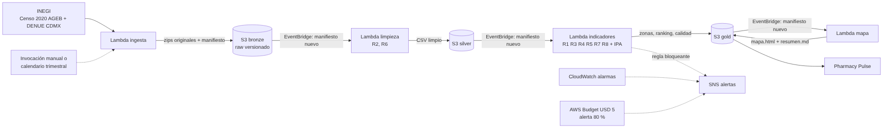

# Documentación del diagrama de arquitectura (v4.0)

Plataforma de datos de Pharmacy Pulse en AWS con cuatro Lambdas. Sustituye a la versión 3.0, que corría el pipeline en local con `make pipeline` (ver [ADR 0002](../adr/0002-lambda-vs-glue.md)).

- **Archivo del diagrama:** [`diagrama-arquitectura.json`](diagrama-arquitectura.json) (formato Diagramon, v4.0).
- **Cómo abrirlo:** en [Diagramon](https://github.com/dataengileb/diagramon), abrir `index.html` y usar **Import**.
- **Imagen:** `arquitectura.png`, generada desde el diagrama Mermaid del README.

## 1. Componentes

| Componente | Función | Plantilla |
|---|---|---|
| INEGI | Censo 2020 por AGEB y manzana urbana (CDMX) y DENUE CDMX | — |
| Lambda `ingesta` | Descarga los zips y escribe en bronze con manifiesto (sha256, tamaño, fecha) | `Lambdas.yaml` |
| Lambda `limpieza` | Filtra las 6 alcaldías, limpia, reglas R2 y R6, escribe silver | `Lambdas.yaml` |
| Lambda `indicadores` | Une por AGEB, competencia a 500 m, reglas R1 R3 R4 R5 R7 R8, IPA y ranking | `Lambdas.yaml` |
| Lambda `mapa` | Mapa estático HTML y resumen Markdown | `Lambdas.yaml` |
| S3 bronze / silver / gold | Data lake medallón, versionado, cifrado y privado | `Buckets.yaml` |
| S3 artifacts | Zips del código de las Lambdas | `Buckets.yaml` |
| EventBridge | Encadena las Lambdas por manifiestos; calendario trimestral apagado | `Lambdas.yaml` |
| SNS | Alertas: reglas bloqueantes, errores, presupuesto | `Lambdas.yaml` |
| CloudWatch | Logs (30 días) y una alarma de errores por Lambda | `Lambdas.yaml` |
| IAM | Un rol por Lambda con mínimo privilegio | `Lambdas.yaml` |
| AWS Budgets | Tope USD 5 al mes, alerta al 80 % y al 100 % pronosticado | `Lambdas.yaml` |

## 2. Flujo de datos

| Paso | De | A | Qué ocurre |
|:---:|---|---|---|
| 1 | Persona o calendario | Lambda `ingesta` | Se lanza la carga (normalmente a mano) |
| 2 | INEGI | S3 bronze | Zips en `censo/fecha=F/` y `denue/fecha=F/`; al final, `_manifiestos/fecha=F.json` |
| 3 | S3 bronze | Lambda `limpieza` | EventBridge detecta el manifiesto |
| 4 | Lambda `limpieza` | S3 silver | Tablas CSV por versión y `_manifiestos/version=F.json` |
| 5 | S3 silver | Lambda `indicadores` | EventBridge detecta el manifiesto |
| 6 | Lambda `indicadores` | S3 gold | Reporte de calidad; si pasa, zonas, ranking y manifiesto |
| 7 | S3 gold | Lambda `mapa` | `mapa/actual/index.html` y `resumen/actual/resumen.md` |
| 8 | S3 gold | Pharmacy Pulse | Ranking, mapa y resumen ejecutivo |

## 3. Cumplimiento del SOW

| Requisito del SOW | Cómo lo cumple | SOW |
|---|---|---|
| Pipeline reproducible en AWS | Cuatro Lambdas en la cuenta del cliente | 1 |
| Zonas `raw/clean/curated` | Buckets bronze, silver y gold | 5.1 |
| Infraestructura como código | Dos plantillas de CloudFormation | 5.2 (ADR 0003) |
| Rol IAM de mínimo privilegio | Un rol por función | 5.2 |
| Costo de $0 efectivo con alerta | Lambda en capa gratuita; Budget USD 5 con alerta al 80 % | 5.5 |
| Reglas de calidad en cada carga | R2/R6 en limpieza; R1, R3, R4, R5, R7, R8 en indicadores | 6.3 |
| Versionado e idempotencia | `fecha=`/`version=` en las rutas; prueba de idempotencia | 6.6 |
| Sin aplicación web ni servidor | Mapa estático en un solo HTML | 4 |

## 4. Cambios respecto a la v3.0

- `make pipeline` local → cuatro Lambdas encadenadas por eventos (ADR 0002).
- Parquet → CSV (ADR 0001). DuckDB o Athena pueden leerlo igual si se necesitan consultas SQL.
- `template.yaml` único → `Buckets.yaml` y `Lambdas.yaml` (ADR 0003).
- Se agregan SNS, CloudWatch y EventBridge, que la v3.0 no contemplaba.
- Marco Geoestadístico ya no se descarga: el DENUE trae la clave de AGEB (ADR 0001).

## 5. Costos estimados (precio de lista, antes de la capa gratuita)

| Servicio | Supuesto | USD por mes |
|---|---|---:|
| Lambda | 1 carga de unos 250 GB-segundo (capa gratuita: 400,000 GB-s al mes) | menos de 0.01 |
| S3 | unos 0.3 GB entre las tres capas | menos de 0.01 |
| EventBridge, SNS, CloudWatch | pocos eventos, correos y 4 alarmas | menos de 0.50 |
| CloudFormation, IAM, Budgets | sin cargo (2 primeros presupuestos) | 0 |
| **Total** | | **menos de USD 1** |

Las alarmas de CloudWatch cuestan unos centavos de dólar al mes cada una fuera de la capa gratuita (que incluye 10). El tope de USD 5 es un límite, no un gasto.
