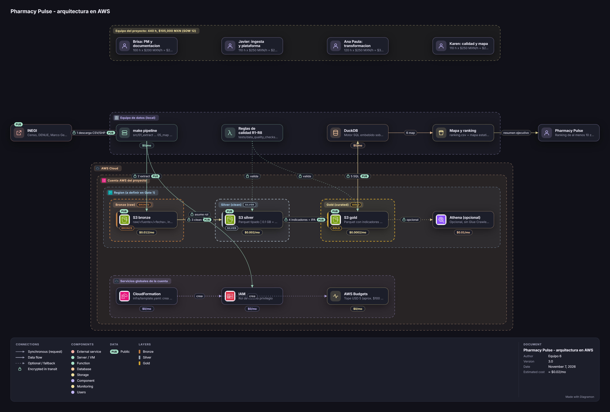

# Documentación del diagrama de arquitectura

Diagrama de la plataforma de datos de Pharmacy Pulse en AWS.

- **Archivo del diagrama:** [`diagrama-arquitectura.json`](diagrama-arquitectura.json)
- **Cómo abrirlo:** en [Diagramon](https://github.com/dataengileb/diagramon), abrir `index.html` y usar **Import**.
- **Fuente:** [`SOW.md`](SOW.md) v2.0, secciones 5 (arquitectura de datos) y 9 (repositorio).

---

## 1. Componentes

### Fuera de AWS

| Componente | Función | SOW |
|---|---|---|
| INEGI | Fuente: Censo, DENUE (CSV completo) y Marco Geoestadístico | 6.1 |
| `make pipeline` | Ejecuta `src/01_extract` a `05_map` (Python) | 5.3 |
| Reglas de calidad | Reglas R1 a R8, en cada carga | 6.3 |
| DuckDB | Consulta SQL sobre los Parquet | 5.4 |
| Mapa y ranking | `ranking.csv` y mapa estático | 3, 8 |
| Pharmacy Pulse | Recibe ranking, mapa y resumen ejecutivo | 1, 8 |

### Dentro de AWS

| Componente | Función | SOW |
|---|---|---|
| CloudFormation | `infra/template.yaml` crea buckets, IAM y presupuesto | 5.2 |
| IAM | Rol de mínimo privilegio para el pipeline | 5.2 |
| AWS Budgets | Tope de USD 5, alerta al 80 % | 5.5 |
| S3 bronze (raw) | Descargas por fuente y fecha, inmutables | 5.1, 6.6 |
| S3 silver (clean) | Parquet tipado y homologado | 5.1 |
| S3 gold (curated) | Parquet con indicadores e IPA | 5.1 |
| Athena (opcional) | Alternativa a DuckDB, sin Glue Crawler | 5.4 |

CloudFormation, IAM y Budgets se dibujan abajo, en el recuadro "Servicios globales de la cuenta", fuera de la región y de las capas, porque son globales y no pertenecen a ninguna zona de datos.

### Por qué DuckDB

- Es un motor SQL embebido: se instala con `pip`, sin servidor ni cluster, y lee Parquet directo desde S3.
- Costo de $0 y sin cómputo permanente en AWS (SOW 4 y 5.5); Athena cobra por dato escaneado y pide catálogo.
- El volumen (Censo, DENUE y geografía de unas cuantas zonas, cientos de MB) cabe en una laptop; Spark o Databricks serían sobredimensionados.
- Un solo analista y ejecución por `make pipeline`: no hay concurrencia que justifique un warehouse.
- Si el volumen crece, Athena (opcional) usa los mismos Parquet de gold sin reescribir nada.

---

## 2. Flujo de datos

| Paso | De | A | Qué ocurre |
|:---:|---|---|---|
| 1 | INEGI | `make pipeline` | Descarga de CSV y SHP |
| 2 | `make pipeline` | S3 bronze | `01_extract` guarda en `raw/<fuente>/<fecha>/` |
| 3 | S3 bronze | S3 silver | `02_clean` escribe Parquet tipado |
| 4 | S3 silver | S3 gold | `03_indicators` y `04_scoring` calculan el IPA |
| 5 | S3 gold | DuckDB | Consulta SQL |
| 6 | DuckDB | Mapa y ranking | `05_map` genera las salidas |

Las transformaciones 3 y 4 las ejecuta `make pipeline`; el diagrama las dibuja directo entre capas para que no se vea saturado.

Las líneas punteadas del diagrama son de control, no de datos:

- **valida:** las reglas de calidad revisan silver y gold.
- **crea:** CloudFormation despliega IAM y presupuesto (y los buckets, vía la plantilla).

---

## 3. Cumplimiento del SOW

| Requisito del SOW | Cómo lo refleja el diagrama | SOW |
|---|---|---|
| Pipeline reproducible en AWS | S3 en tres zonas, dentro de cuenta y región | 1 |
| Scripts leen y escriben en S3, no en disco local | Los pasos 2 a 4 van contra los buckets | 5.1 |
| Infraestructura como código | CloudFormation crea S3, IAM y Budgets | 5.2 |
| Rol IAM de mínimo privilegio | Nodo IAM; el pipeline asume el rol | 5.2 |
| Costo de $0 efectivo con alerta | AWS Budgets, tope USD 5; S3 con costo 0 | 5.5 |
| Ejecución por comando | `make pipeline` local, sin Lambda ni EventBridge | 5.3 |
| DuckDB base, Athena alternativa | DuckDB local; Athena marcado opcional; sin Glue | 5.4 |
| Reglas de calidad en cada carga | Nodo de reglas que valida `clean` y `curated` | 6.3 |
| Sin aplicación web ni servidor | Sin cómputo permanente en AWS; mapa estático | 4 |

---

## 4. Alcance y límites del diagrama

- **Región:** el SOW no la fija. Se decide en el Gate 1.
- **Procesos, no componentes:** el linaje, el versionado de `raw` por fecha y la etiqueta de confianza (SOW 6.4 a 6.6) no se dibujan como nodos.
- **Sustituto de ingreso:** se define en el hito 1 (SOW 7.5) y no aparece.
- **Ícono de AWS Budgets:** Diagramon no trae uno oficial; usa uno genérico.
- **Costos (SOW 12.3):** estimación de aprox. 0.03 USD al mes (cerca de $0.5 MXN) a precio de lista, antes del free tier: S3 bronze 0.012, silver 0.002, gold 0.0002 y Athena opcional 0.01. CloudFormation, IAM, Budgets, DuckDB y `make pipeline` van en 0. AWS Budgets lleva el tope de USD 5 (aprox. $100 MXN) y la alerta al 80 %; el tope es un límite, no un gasto.
- **Supuestos:** los volúmenes (0.5, 0.1 y 0.01 GB) son del equipo y se confirman con la primera descarga; el free tier y la región se revisan antes del Gate 1.
- **Servicios no incluidos:** VPC, KMS, CloudWatch y Lambda, porque el SOW no los contempla.
- **Estado:** el JSON es válido y sus referencias existen. Importado en Diagramon el 2026-11-07: 13 componentes, 13 conexiones, sin avisos. Falta regenerar el PNG de arriba, que sigue siendo el de la versión anterior.
